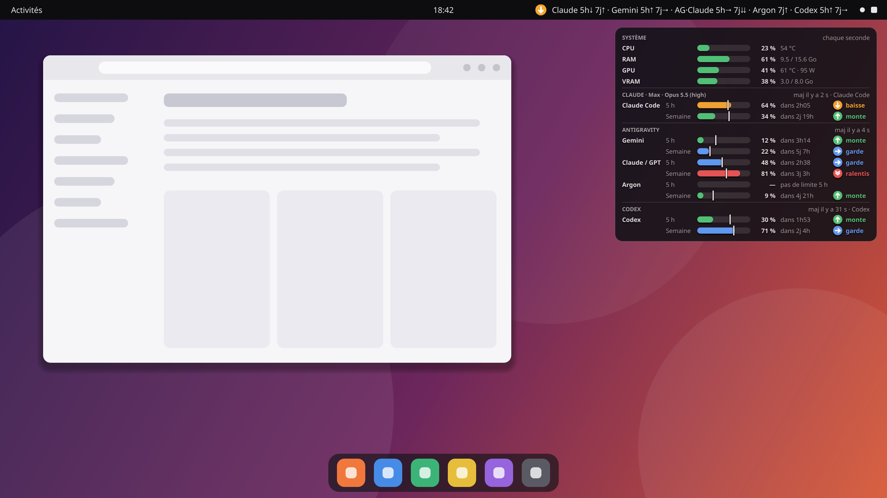

# Salut, moi c'est Max 👋

**Étudiant à [42](https://42.fr)** · j'apprends le développement en construisant des projets concrets

## 🎓 Mon parcours à 42

À 42, pas de professeurs ni de cours magistraux : on apprend par projets, en peer-learning, en corrigeant et en se
faisant corriger par les autres étudiants.

Quelques projets du cursus sur lesquels j'ai travaillé :
`Libft` · `ft_printf` · `get_next_line` · `push_swap` · `pipex` · `so_long` · `minishell` · `philosophers` · `cub3D`

## 🚀 En ce moment

### [ImproveQuotaIa](https://github.com/Maxft68/ImproveQuotaIa)

Une application open source (Linux, macOS, Windows) qui te dit en direct si tu peux passer sur un modèle d'IA plus
puissant ou s'il vaut mieux ralentir, selon tes quotas Claude Code, Antigravity, Codex, Grok, Copilot… Texte dans la
barre du haut, HUD translucide, et aucune clé API à saisir.

## 🛠️ Langages et outils

## 🤝 Échangeons

Toujours partant pour un retour, une idée ou une collaboration : ouvre une issue sur un de mes projets, je réponds avec
plaisir.

---

🇬🇧 Hi, I'm Max, a student at 42. I learn by building real projects, currently
[ImproveQuotaIa](https://github.com/Maxft68/ImproveQuotaIa): an open-source app that tells you live whether you can move
up to a bigger AI model or should slow down, based on your coding quotas.
